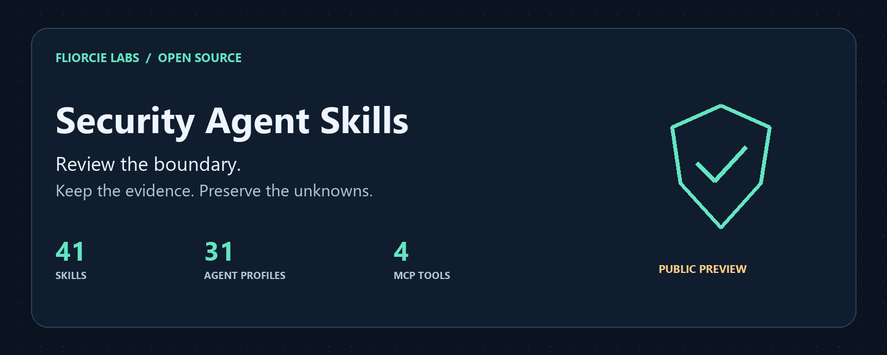

# Security Agent Skills

[English](README.md) · [日本語](README.ja.md) · [简体中文](README.zh-CN.md) · [한국어](README.ko.md) · [हिन्दी](README.hi.md) · Español



Revisa localmente los límites de seguridad de tus herramientas de IA y proyectos. Carga solo la habilidad relevante y conserva las evidencias, el alcance pendiente y las incertidumbres.

Esta página es una introducción resumida y traducida. El catálogo completo, los contratos de entrada y los cambios actuales están en la [documentación en inglés](README.md). Las instrucciones de las habilidades y los identificadores del código no están traducidos.

## Qué incluye

| Tipo | Función |
|---|---|
| 41 habilidades | Revisar indicios de salida de datos, procedencia de dependencias, permisos MCP, límites de aplicaciones y operaciones internas de agentes |
| 31 perfiles | Roles Markdown con reglas de alcance, evidencia y resultados |
| Cuatro herramientas MCP | Analizar rutas de ataque declaradas, reproducción de detecciones, comparaciones de regresión y selección de habilidades mediante stdio |

## Primera revisión local

Requiere Python 3.11 o posterior. Sustituye la ruta de destino por una carpeta de proyecto existente.

```sh
git clone https://github.com/FliorcieLabs/security-agent-skills.git
cd security-agent-skills
python scripts/security_check.py egress ../my-project --format markdown --max-findings 5
```

Las revisiones estáticas devuelven el código de salida `3`, `PARTIAL`, incluso sin indicios. Ese resultado conserva los límites de cobertura; no demuestra que el proyecto sea seguro.

Se han probado las rutas de instalación y la ejecución independiente de los auxiliares para Claude Code, Codex, Cursor y entornos compatibles de Copilot. No se ha verificado la detección automática ni una sesión real en cada plataforma. No se garantiza compatibilidad nativa con cualquier IA. [Instalación](README.md#install-for-your-assistant) · [Compatibilidad](docs/compatibility.md)

## Estado y límites

`0.1.0a4` es una versión preliminar de desarrollo. Los auxiliares locales no requieren claves API ni dependencias adicionales de Python en ejecución. No realizan solicitudes de red independientes ni ejecutan el código revisado. El contenido enviado a un asistente sigue sujeto a la política de datos de su proveedor.

Los quince auxiliares de dominio comprueban registros de evidencia declarados; no escanean proyectos ni verifican las referencias por su cuenta. No ejecutan pruebas de penetración, DDoS ni entornos aislados. Los hallazgos son pistas de revisión, no vulnerabilidades confirmadas ni certificaciones de seguridad.

## Proyectos públicos de Fliorcie Labs

| Proyecto | Función |
|---|---|
| [Security Agent Skills](https://github.com/FliorcieLabs/security-agent-skills) | Revisión local de seguridad y operaciones de agentes |
| [LLMWitness Community](https://github.com/FliorcieLabs/LLMWitness) | Telemetría para desarrollo localhost de un usuario, depuración de patrones de mejor esfuerzo y recibos locales con detección de alteraciones |
| [Fliorcie Bench](https://github.com/FliorcieLabs/fliorcie-bench) | Registros locales de rendimiento y conformidad |
| [Evidence Bundle Verifier](https://github.com/FliorcieLabs/fliorcie-evidence-bundle-verifier) | Comprobación sin conexión de estructura e integridad interna de paquetes de evidencia |
| [Provider Adapter Kit](https://github.com/FliorcieLabs/fliorcie-provider-adapter-kit) | Protocolo de adaptadores y pruebas locales de conformidad, sin llamadas a proveedores reales |

Cada proyecto tiene su propio estado y licencia. El código original usa MIT; dos módulos auxiliares adaptados conservan Apache-2.0. [Avisos de terceros](THIRD_PARTY_NOTICES.md) · [Contribuir](CONTRIBUTING.md)
