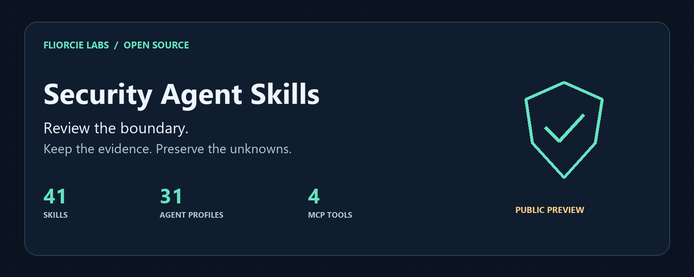

# Security Agent Skills

[English](README.md) · [日本語](README.ja.md) · [简体中文](README.zh-CN.md) · [한국어](README.ko.md) · हिन्दी · [Español](README.es.md)



AI टूल और प्रोजेक्ट की सुरक्षा सीमाओं की स्थानीय समीक्षा करें। केवल ज़रूरी स्किल लोड करें और रिपोर्ट में प्रमाण, छूटा हुआ दायरा तथा अनिश्चित बातें बनाए रखें।

यह पेज शुरुआती जानकारी का संक्षिप्त अनुवाद है। पूरी सूची, इनपुट नियम और नवीनतम बदलाव [अंग्रेज़ी दस्तावेज़](README.md) में हैं। स्किल के निर्देश और कोड पहचानकर्ता अनूदित नहीं हैं।

## क्या मिलता है

| प्रकार | उपयोग |
|---|---|
| 41 स्किल | बाहरी डेटा प्रवाह के संकेत, निर्भरता का स्रोत, MCP अधिकार, ऐप की सीमाएँ और एजेंट के आंतरिक काम की समीक्षा |
| 31 प्रोफ़ाइल | दायरे और प्रमाण के नियमों वाली Markdown भूमिका परिभाषाएँ |
| चार MCP टूल | घोषित आक्रमण पथ, डिटेक्शन रीप्ले, रिग्रेशन तुलना और स्किल चयन का stdio से विश्लेषण |

## स्थानीय समीक्षा शुरू करें

Python 3.11 या नया संस्करण चाहिए। लक्ष्य पथ की जगह अपने मौजूदा प्रोजेक्ट का फ़ोल्डर दें।

```sh
git clone https://github.com/FliorcieLabs/security-agent-skills.git
cd security-agent-skills
python scripts/security_check.py egress ../my-project --format markdown --max-findings 5
```

स्थिर समीक्षा में कोई संकेत न मिलने पर भी एग्ज़िट कोड `3` और `PARTIAL` आता है। इसका मतलब सीमित जाँच है, प्रोजेक्ट के सुरक्षित होने का प्रमाण नहीं।

Claude Code, Codex, Cursor और समर्थित Copilot परिवेशों के इंस्टॉलेशन फ़ोल्डर और स्वतंत्र हेल्पर का परीक्षण हुआ है। हर प्लेटफ़ॉर्म पर स्वतः खोज और वास्तविक संवाद सत्र सत्यापित नहीं हैं। किसी भी AI प्लेटफ़ॉर्म पर मूल एकीकरण की गारंटी नहीं है। [इंस्टॉलेशन](README.md#install-for-your-assistant) · [अनुकूलता](docs/compatibility.md)

## स्थिति और सीमाएँ

`0.1.0a4` विकास प्रीव्यू है। स्थानीय हेल्पर को API कुंजी या अतिरिक्त Python रनटाइम निर्भरता नहीं चाहिए। वे स्वयं नेटवर्क अनुरोध नहीं भेजते और समीक्षा किए जा रहे कोड को नहीं चलाते। AI होस्ट को दी गई सामग्री पर उसके प्रदाता की डेटा नीति लागू होती है।

15 विषय-विशेष हेल्पर घोषित प्रमाण रिकॉर्ड की संगति जाँचते हैं। वे प्रोजेक्ट को स्वतः स्कैन या प्रमाण को स्वतंत्र रूप से सत्यापित नहीं करते। ये पेनिट्रेशन टेस्ट, DDoS या सैंडबॉक्स नहीं चलाते। निष्कर्ष समीक्षा के संकेत हैं, पक्की कमज़ोरी या सुरक्षा प्रमाणपत्र नहीं।

## Fliorcie Labs के सार्वजनिक प्रोजेक्ट

| प्रोजेक्ट | उपयोग |
|---|---|
| [Security Agent Skills](https://github.com/FliorcieLabs/security-agent-skills) | स्थानीय सुरक्षा समीक्षा और एजेंट संचालन |
| [LLMWitness Community](https://github.com/FliorcieLabs/LLMWitness) | एक उपयोगकर्ता के localhost विकास के लिए टेलीमेट्री, यथासंभव पैटर्न स्क्रबिंग और स्थानीय छेड़छाड़ पहचान योग्य रसीदें |
| [Fliorcie Bench](https://github.com/FliorcieLabs/fliorcie-bench) | स्थानीय बेंचमार्क और अनुरूपता रिकॉर्ड |
| [Evidence Bundle Verifier](https://github.com/FliorcieLabs/fliorcie-evidence-bundle-verifier) | प्रमाण बंडल की संरचना और आंतरिक अखंडता की ऑफ़लाइन जाँच |
| [Provider Adapter Kit](https://github.com/FliorcieLabs/fliorcie-provider-adapter-kit) | अडैप्टर प्रोटोकॉल और स्थानीय अनुरूपता परीक्षण, वास्तविक प्रदाता कॉल नहीं |

हर प्रोजेक्ट की स्थिति और लाइसेंस अलग देखें। मूल कोड MIT है; दो अनुकूलित हेल्पर मॉड्यूल Apache-2.0 के अंतर्गत हैं। [तृतीय पक्ष सूचना](THIRD_PARTY_NOTICES.md) · [योगदान](CONTRIBUTING.md)
