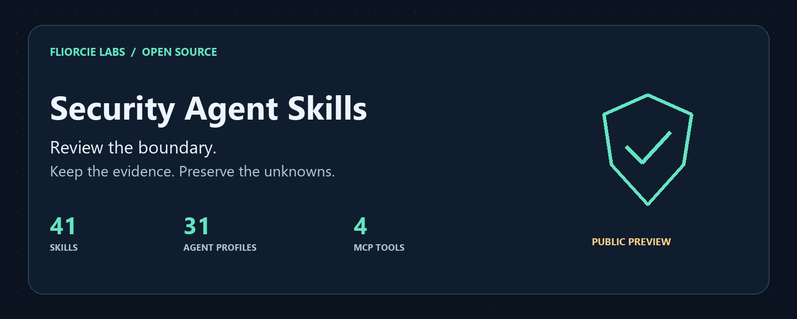

# Security Agent Skills

[English](README.md) · 日本語 · [简体中文](README.zh-CN.md) · [한국어](README.ko.md) · [हिन्दी](README.hi.md) · [Español](README.es.md)



AI ツールとプロジェクトの境界を、ローカルで確認するためのセキュリティレビュー集です。証拠、確認できなかった範囲、不明点を残しながら、必要なスキルだけを読み込みます。

このページは導入ガイドの抄訳です。完全なカタログ、入力仕様、更新情報は [英語版](README.md) を参照してください。手順とコード識別子は翻訳していません。

## できること

| 種類 | 内容 |
|---|---|
| 41 のスキル | 外部送信の兆候、依存関係、MCP 権限、アプリケーション境界、エージェント運用のレビュー |
| 31 のプロファイル | 対象範囲と証拠のルールを持つ Markdown の役割定義 |
| 4 つの MCP ツール | 申告された攻撃経路、検知リプレイ、回帰比較、スキル選択を stdio で処理 |

## 最初のローカルレビュー

Python 3.11 以降が必要です。対象フォルダーを自分のプロジェクトに置き換えてください。

```sh
git clone https://github.com/FliorcieLabs/security-agent-skills.git
cd security-agent-skills
python scripts/security_check.py egress ../my-project --format markdown --max-findings 5
```

静的レビューは、兆候が見つからなくても終了コード `3`、`PARTIAL` を返します。これは対象の安全性が証明されていないことを示します。

Claude Code、Codex、Cursor、対応する Copilot 環境向けの配置とヘルパー実行はテスト済みです。すべての環境での自動検出や対話動作は未検証です。任意の AI でのネイティブ対応は保証しません。[インストール](README.md#install-for-your-assistant) · [互換性](docs/compatibility.md)

## 制限とデータの扱い

バージョン `0.1.0a4` は開発プレビューです。ローカルヘルパーに API キーや追加の Python 実行時依存関係は不要です。ヘルパーは独自のネットワーク要求や解析対象コードの実行を行いません。AI ホストに渡した内容には、そのプロバイダーのデータ方針が適用されます。

15 の分野別ヘルパーは申告された証拠の整合性を確認するもので、プロジェクトの自動スキャナーではありません。侵入テスト、DDoS、サンドボックス実行は行いません。指摘は確認の手がかりであり、確定した脆弱性や安全性の証明ではありません。

## Fliorcie Labs の公開プロジェクト

| プロジェクト | 用途 |
|---|---|
| [Security Agent Skills](https://github.com/FliorcieLabs/security-agent-skills) | ローカルのセキュリティレビューとエージェント運用 |
| [LLMWitness Community](https://github.com/FliorcieLabs/LLMWitness) | 単一ユーザーの localhost 開発向けテレメトリー、ベストエフォートのパターンスクラビング、ローカルの改ざん検知可能なレシート |
| [Fliorcie Bench](https://github.com/FliorcieLabs/fliorcie-bench) | ローカルのベンチマークと適合性の記録 |
| [Evidence Bundle Verifier](https://github.com/FliorcieLabs/fliorcie-evidence-bundle-verifier) | 証拠バンドルの形式と内部整合性のオフライン確認 |
| [Provider Adapter Kit](https://github.com/FliorcieLabs/fliorcie-provider-adapter-kit) | アダプタープロトコルとローカルの適合性テスト。実プロバイダーには接続しません |

各プロジェクトの状態とライセンスは個別に確認してください。元のコードは MIT、2 つの派生ヘルパーモジュールは Apache-2.0 です。[第三者ライセンス](THIRD_PARTY_NOTICES.md) · [貢献](CONTRIBUTING.md)
