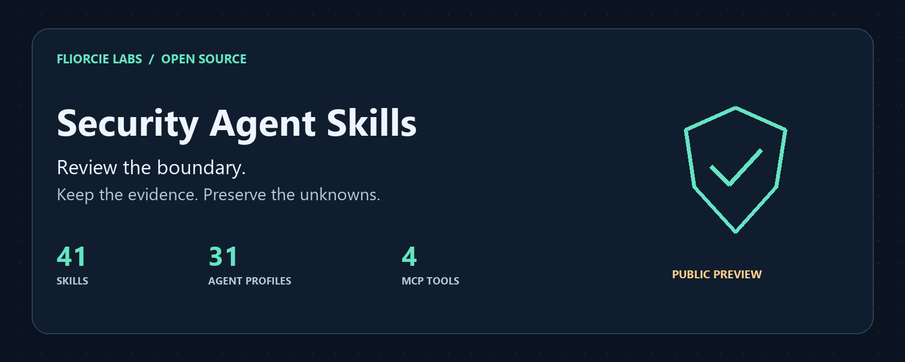

# Security Agent Skills

[English](README.md) · [日本語](README.ja.md) · [简体中文](README.zh-CN.md) · 한국어 · [हिन्दी](README.hi.md) · [Español](README.es.md)



AI 도구와 프로젝트의 보안 경계를 로컬에서 검토합니다. 필요한 스킬만 불러오고 증거, 확인하지 못한 범위, 알 수 없는 항목을 유지합니다.

이 페이지는 시작 안내의 요약 번역입니다. 전체 목록과 입력 계약, 최신 변경 사항은 [영문 문서](README.md)를 참고하세요. 스킬 지침과 코드 식별자는 번역하지 않았습니다.

## 구성

| 유형 | 용도 |
|---|---|
| 스킬 41개 | 외부 전송 징후, 의존성 출처, MCP 권한, 애플리케이션 경계와 에이전트 내부 작업 검토 |
| 프로필 31개 | 범위와 증거 규칙을 정의하는 Markdown 역할 문서 |
| MCP 도구 4개 | 선언된 공격 경로, 탐지 재생, 회귀 비교, 스킬 선택을 stdio로 분석 |

## 로컬 검토 시작

Python 3.11 이상이 필요합니다. 대상 경로를 기존 프로젝트 폴더로 바꾸세요.

```sh
git clone https://github.com/FliorcieLabs/security-agent-skills.git
cd security-agent-skills
python scripts/security_check.py egress ../my-project --format markdown --max-findings 5
```

정적 검토는 징후가 없어도 종료 코드 `3`과 `PARTIAL`을 반환합니다. 대상의 안전성을 입증한 결과가 아닙니다.

Claude Code, Codex, Cursor 및 지원되는 Copilot 환경의 설치 경로와 독립 실행 도우미는 테스트했습니다. 모든 호스트의 자동 검색과 실제 대화 세션은 검증하지 않았습니다. 모든 AI 플랫폼의 네이티브 호환성을 보장하지 않습니다. [설치](README.md#install-for-your-assistant) · [호환성](docs/compatibility.md)

## 상태와 한계

`0.1.0a4`는 개발 프리뷰입니다. 로컬 도우미는 API 키나 추가 Python 런타임 의존성 없이 실행되며 자체 네트워크 요청이나 검토 대상 코드 실행을 하지 않습니다. AI 호스트에 전달한 내용에는 해당 제공업체의 데이터 정책이 적용됩니다.

15개 분야별 도우미는 선언된 증거 기록의 일관성을 확인합니다. 프로젝트를 자동 스캔하거나 증거를 독립적으로 검증하지 않습니다. 침투 테스트, DDoS, 샌드박스 실행 도구가 아닙니다. 탐지 결과는 검토 단서이며 확정된 취약점이나 안전성 인증이 아닙니다.

## Fliorcie Labs 공개 프로젝트

| 프로젝트 | 용도 |
|---|---|
| [Security Agent Skills](https://github.com/FliorcieLabs/security-agent-skills) | 로컬 보안 검토와 에이전트 운영 절차 |
| [LLMWitness Community](https://github.com/FliorcieLabs/LLMWitness) | 단일 사용자 localhost 개발용 텔레메트리, 최선 노력 방식의 패턴 스크러빙, 로컬 변조 탐지 가능 영수증 |
| [Fliorcie Bench](https://github.com/FliorcieLabs/fliorcie-bench) | 로컬 벤치마크와 적합성 기록 |
| [Evidence Bundle Verifier](https://github.com/FliorcieLabs/fliorcie-evidence-bundle-verifier) | 증거 번들의 구조와 내부 무결성을 오프라인으로 확인 |
| [Provider Adapter Kit](https://github.com/FliorcieLabs/fliorcie-provider-adapter-kit) | 어댑터 프로토콜과 로컬 적합성 테스트. 실제 제공업체 호출 없음 |

프로젝트마다 상태와 라이선스가 다릅니다. 원본 코드는 MIT이며 수정해 도입한 두 도우미 모듈은 Apache-2.0을 유지합니다. [제삼자 고지](THIRD_PARTY_NOTICES.md) · [기여](CONTRIBUTING.md)
