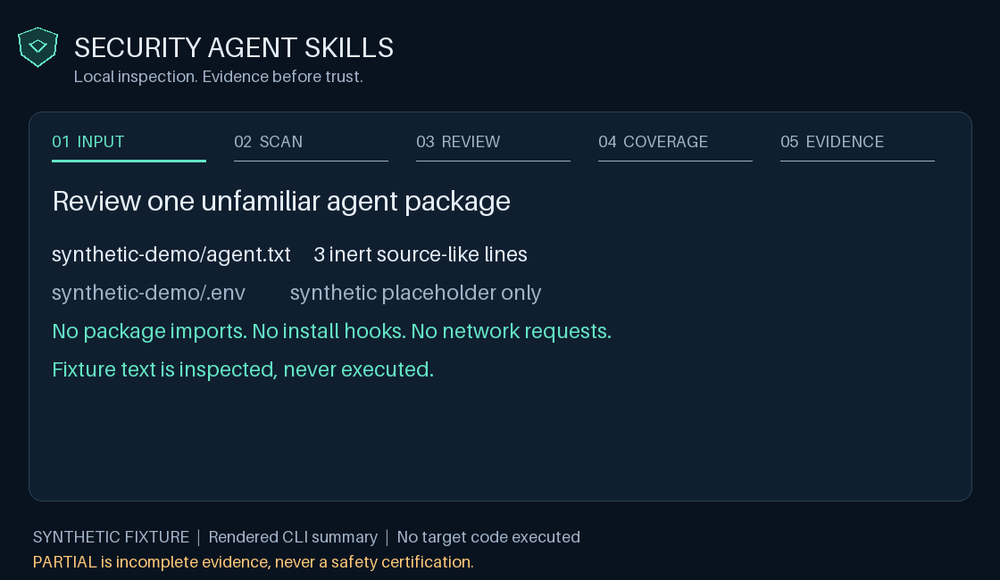

# Security Agent Skills


**Know what an AI agent can read, run, and send.**

[](https://github.com/FliorcieLabs/security-agent-skills/actions/workflows/quality.yml?query=branch%3Ainteg)
[](LICENSE)
[](pyproject.toml)

Twenty local skills and ten portable agent profiles for security review and internal agent operations. Inspect unfamiliar AI tooling, review project boundaries, plan bounded tasks, prepare handoffs, checkpoint context, and review tool or retry proposals before execution.

**No API key. No runtime Python dependencies. No telemetry. No source upload.** Analysis helpers read bounded local inputs without importing or executing reviewed code.

[Quick start](#start-with-one-folder) · [Demo](#see-a-local-review) · [Security skills](#choose-the-security-question) · [Agent operations](#internal-agent-operations) · [Install](#install-for-your-assistant) · [10 agents](#portable-agent-profiles) · [Limits](#privacy-and-limits) · [Contribute](CONTRIBUTING.md)

Use it before installing an unfamiliar agent package, granting an MCP server access, accepting a dependency change, or sharing a security finding. Start with one question and one skill. Review the referenced source before deciding what to allow or fix.

## Start with one folder

The implementation is on `integ` while its protected-main pull request is under review:

```sh
git clone --branch integ https://github.com/FliorcieLabs/security-agent-skills.git
cd security-agent-skills
python scripts/security_check.py egress ../my-project --format markdown --max-findings 5
```

Replace `../my-project` with an existing project folder. Python 3.11+ is required; use `python3` or `py -3` if that is your interpreter command. Static scans return **exit 3, PARTIAL**, including when they find no indicators. This is an intentional evidence status, not a crashed command.

## See a local review



**Synthetic inputs, actual CLI results.** This rendered summary shows the egress helper inspecting inert source-like text. It finds sensitive input access, a network client call, and a process execution boundary. The console is limited to two findings; the full report retains all three. A synthetic `.env` file is skipped. No fixture code runs and no outbound request is made.

Prefer a still image? [Open the PNG sample](docs/assets/security/security-demo.png). Read the [text walkthrough](docs/assets/security/README.md), [compact JSON](docs/assets/security/demo-compact.json), or [full JSON](docs/assets/security/demo-report.json). The demo is a presentation of one local scan, not a recording of an AI assistant or a confirmed attack.

### Pick a review path

| Your task | Start here | Follow with |
|---|---|---|
| Adopt a new skill or agent | Agent Egress Audit | Instruction Boundary Audit and Dependency Provenance Audit |
| Grant an MCP server access | MCP Authority Review | Agent Egress Audit for the server package |
| Review a deployment change | CI Workflow Security Audit | Container Boundary Audit or Infrastructure Exposure Audit |
| Check AI data settings | LLM Data Boundary Audit | Trace the flagged endpoint or capture setting in the source |
| Review a package upgrade | Agent Package Change Sentinel | A focused audit of the changed files |

Each path narrows the next decision. It does not combine the results into a safety score.

## Choose the security question

| Skill | What it reviews or produces | CLI command |
|---|---|---|
| [Agent Egress Audit](skills/agent-egress-audit) | Outbound clients, tracking indicators, sensitive input access, and execution boundaries. | `egress` |
| [Dependency Provenance Audit](skills/dependency-provenance-audit) | Local manifests, lockfiles, lifecycle hooks, mutable sources, and integrity records. | `dependencies` |
| [MCP Authority Review](skills/mcp-authority-review) | Endpoints, shell launch authority, credential configuration, and tool restrictions. | `mcp` |
| [Security Exposure Review](skills/security-exposure-review) | Evaluation, deserialization, debug, listener, and shell review leads. | `exposure` |
| [Authorized AppSec Validation](skills/authorized-appsec-validation) | A declared authorization document, exact targets, time window, budgets, and stop conditions. | `appsec-plan` |
| [Agent Package Change Sentinel](skills/agent-package-change-sentinel) | Local content snapshots and diffs for changed files and new capability indicators. | `snapshot`, `compare` |
| [Prompt Injection Boundary Lab](skills/prompt-injection-boundary-lab) | Five synthetic boundary cases and grading of supplied response records. | `injection-lab` |
| [Secret Route Mapper](skills/secret-route-mapper) | Supplied synthetic canary route events. No credential collection or packet capture. | `routes` |
| [Safe Install Sandbox](skills/safe-install-sandbox) | An inert, digest-pinned Docker execution plan with restricted authority. | `sandbox-plan` |
| [Security Evidence Pack](skills/security-evidence-pack) | Reproducible report ZIPs and exact-member/hash verification. | `pack`, `verify` |
| [Instruction Boundary Audit](skills/instruction-boundary-audit) | Agent instruction overrides, approval bypass language, concealed transfers, and invisible text. | `instructions` |
| [CI Workflow Security Audit](skills/ci-workflow-security-audit) | GitHub Actions references, triggers, permissions, inherited secrets, runner selection, and event expressions. | `ci` |
| [Container Boundary Audit](skills/container-boundary-audit) | Explicit root users, privileged containers, host namespaces, daemon sockets, escalation settings, and remote ADD sources. | `containers` |
| [Infrastructure Exposure Audit](skills/infrastructure-exposure-audit) | Literal Terraform HCL world ranges, wildcard policy scope, public storage, encryption, and validation settings. | `iac` |
| [LLM Data Boundary Audit](skills/llm-data-boundary-audit) | Explicit content capture, disabled scrubbing, remote code trust, configured endpoints, and TLS bypasses. | `llm-data` |

Use a directory as the target for each static command. Read the skill's workflow reference for structured inputs to the other commands. [Capabilities and limits](docs/capabilities.md) describe what each helper can establish.

## Internal agent operations

These five skills help an assistant manage its work with explicit scope, evidence, and stop conditions. Their helpers validate supplied JSON records locally. They do not provide a background agent runtime or invoke tools on your behalf.

| Skill | Internal operation | CLI command |
|---|---|---|
| [Agent Task Planner](skills/agent-task-planner) | Checks a task dependency graph, write ownership, evidence requirements, and step caps. | `task-plan` |
| [Agent Handoff Review](skills/agent-handoff-review) | Checks permission subsets, acceptance references, evidence, and completion claims. | `handoff` |
| [Agent Context Checkpoint](skills/agent-context-checkpoint) | Builds a reference-only capsule while retaining constraints, evidence, revision, unresolved work, and next action. | `checkpoint` |
| [Agent Tool Preflight](skills/agent-tool-preflight) | Compares a proposed tool action with declared tools, resources, effects, transfer policy, and approval requirements. | `preflight` |
| [Agent Retry Guard](skills/agent-retry-guard) | Stops after success or a recorded effect, bounds attempts, and requires reconciliation for unknown write outcomes. | `retry` |

Try the supplied synthetic records:

```sh
python scripts/security_check.py task-plan examples/internal-operations/task-plan.json
python scripts/security_check.py checkpoint examples/internal-operations/checkpoint.json --max-findings 5
python scripts/security_check.py preflight examples/internal-operations/preflight.json
python scripts/security_check.py retry examples/internal-operations/retry.json
```

The task-plan example passes its declared consistency checks. Checkpoint and matching preflight return PARTIAL (exit 3). The retry example deliberately returns BLOCKED (exit 2): it describes a write with an unknown outcome. Neither result executes an action or grants authority.

Example request:

> Use Agent Context Checkpoint to prepare a resume packet for this task. Preserve the current revision, user constraints, evidence references, unresolved work, and next action. Keep optional history out of the packet and report any omissions. Do not write host memory or upload the checkpoint.

Use symbolic local references instead of raw prompts, credentials, payloads, or entire transcripts. Resolve those references and verify freshness before resuming. The reference budget is not a token count. [Operation contracts and examples](docs/internal-operations.md).

## Install for your assistant

Preview one skill for an existing project, then apply the plan:

```sh
python scripts/install_skills.py --agent codex --project ../my-project --skill instruction-boundary-audit
python scripts/install_skills.py --agent codex --project ../my-project --skill instruction-boundary-audit --apply
```

Choose `claude`, `codex`, `cursor`, `copilot`, or `all`. Omit `--skill` to select all twenty. Replace `--project ../my-project` with `--global` for personal discovery across projects. Existing destinations are refused, never silently upgraded or overwritten.

| Assistant | Project skills | Personal skills |
|---|---|---|
| Claude Code | `.claude/skills/` | `~/.claude/skills/` |
| Codex | `.agents/skills/` | `~/.agents/skills/` |
| Cursor | `.cursor/skills/` | `~/.cursor/skills/` |
| GitHub Copilot on supported surfaces | `.github/skills/` | `~/.copilot/skills/` |

Each bundle includes its own helper and can run from another folder without this checkout. The installer does not enable hooks, grant permissions, install dependencies, edit project instructions, or force a reload. A failed copy may leave its new folder for inspection. Older clients and cloud sessions can have different discovery rules. [Compatibility details](docs/compatibility.md).

## Portable agent profiles

- [Instruction Boundary Auditor](agents/instruction-boundary-audit.md)
- [CI Workflow Security Reviewer](agents/ci-workflow-security-audit.md)
- [Container Boundary Reviewer](agents/container-boundary-audit.md)
- [Infrastructure Exposure Reviewer](agents/infrastructure-exposure-audit.md)
- [LLM Data Boundary Reviewer](agents/llm-data-boundary-audit.md)
- [Agent Task Planner](agents/agent-task-planner.md)
- [Agent Handoff Reviewer](agents/agent-handoff-review.md)
- [Agent Context Checkpoint Keeper](agents/agent-context-checkpoint.md)
- [Agent Tool Preflight Reviewer](agents/agent-tool-preflight.md)
- [Agent Retry Guard](agents/agent-retry-guard.md)

Attach a profile or load its text into an assistant that accepts Markdown instructions. Each matching installed skill carries its profile in `references/agent.md`. These are portable instructions, not universal native agent registrations. Without filesystem access, an assistant can review supplied excerpts and report partial coverage. Running helpers requires terminal access and Python. [Agent usage](docs/agents.md).

Example request:

> Use the CI Workflow Security Reviewer on this project's GitHub Actions workflows. Keep analysis local. Report file and line evidence, effective-authority questions, and the smallest fixes. Preserve unknowns and list the commands actually run.

Pass the project root to the `ci` helper so `.github/workflows` retains its expected relative path. In Codex, explicitly invoke `$ci-workflow-security-audit`; in Claude Code, use `/ci-workflow-security-audit`. Other hosts can use their skill picker or a natural-language request.

## Spend context on decisions

```sh
python scripts/security_check.py llm-data ../my-project --max-findings 5 --output llm-review.json
```

The console shows up to five findings plus the total count, omitted count, coverage, and limitations. The new `llm-review.json` file keeps the complete report. Keep output outside the target when comparing snapshots.

Deterministic local work, one relevant skill, references opened on demand, and focused source review reduce repeated context. Stable finding IDs let follow-ups refer to saved evidence instead of replaying the whole report.

The [synthetic benchmark](docs/report-benchmark.md) measured **78,487 to 1,157 `cl100k_base` tokens**, a **98.53% reduction** when compacting a 1,000-finding fixture to twenty visible findings. This measures serialization, not real-project savings, model quality, or billing. Full evidence remains available separately.

Keep a follow-up small: pass the saved report, relevant finding IDs, and the source lines needed to resolve them. Raise `--max-findings` when a decision needs more evidence. An omitted finding remains unresolved until reviewed.

## One result contract

Every report uses [`security-agent-skills/report-v1`](schemas/report-v1.schema.json), retaining workflow, scope, findings, coverage, limitations, and details. Findings have stable IDs, rule names, source locations, and confidence. Lexical matches are review leads, not confirmed vulnerabilities.

| Exit | Result | Meaning |
|---|---|---|
| `0` | PASS or generated data | The named bounded check passed, or inert fixture/snapshot data was generated. |
| `1` | FIX | Supplied evidence fails a bounded check. |
| `2` | BLOCKED | Required input, access, schema, or a new output path is missing. |
| `3` | PARTIAL | Evidence is incomplete or the operation is static. |

Agent profiles use Result, Findings, Coverage, Validation, and Remaining. Passing package tests does not turn a partially inspected target into a safe target.

For example, the [demo's compact report](docs/assets/security/demo-compact.json) keeps `finding_count: 3`, `omitted_findings: 1`, and `runtime_observed: false` together. A short report still tells the reviewer what remains unseen.

## Privacy and limits

- Analysis helpers make no network requests and execute no reviewed code. Explicit development commands can download public build or test dependencies.
- Inventory excludes links, reparse points, hardlinks, credential filenames, binaries, dependency folders, unreadable files, and over-budget inputs. Coverage records skips.
- Static findings omit source excerpts and configuration values. Reports still include scope paths and filenames. Evidence export omits scope paths and freeform details and applies best-effort pattern scrubbing. Inspect artifacts before sharing.
- New audits are lexical, line-based checks. They do not evaluate complete YAML/HCL semantics, templates, inherited permissions, provider defaults, or runtime data flows. Quoted examples and negations can produce leads.
- AppSec validation checks declared scope without making requests. Injection grading consumes supplied records. Route mapping consumes synthetic events. Sandbox generation does not launch Docker. Evidence hashes establish local consistency, not authenticity or external truth.
- Internal-operation records are declarations. Helpers do not open evidence references, verify their freshness, resolve resource aliases, or observe actual tool effects. A matching preflight is PARTIAL and never grants host permission. Checkpoints contain reference IDs that may themselves be sensitive; review before sharing.
- No helper proves absence of malware, certifies compliance, or grants permission for active tests. No DDoS executor, hidden telemetry, or automatic package publishing is included.

## Develop and verify

Runtime helpers use Python 3.11+ standard library only. Optional development tools are pinned in `requirements-dev.txt`.

```sh
python -m unittest discover -s tests -t . -v
python scripts/build_skills.py --check
python scripts/validate_skills.py
python scripts/validate_specs.py
python scripts/benchmark_reports.py
```

Tests cover scanner boundaries, source non-execution, output privacy, incomplete coverage, no-overwrite installation, archive integrity, and installed-helper subprocesses across all four directory layouts. CI runs Python 3.11 and 3.14 on Linux, Windows, and macOS. These tests do not establish interactive recognition or decision quality inside every AI product.

See [CONTRIBUTING.md](CONTRIBUTING.md) for lint, types, formatting, build, and installed-wheel checks, [SECURITY.md](SECURITY.md) for vulnerability reporting, and [.specs](.specs/README.md) for requirements and evidence.

Documentation artwork and demo sources live in [docs/assets/security](docs/assets/security/README.md). They are local assets, so the README does not depend on a third-party GIF host. The optional Pillow renderer is for documentation authors only; it is not a runtime dependency.

`integ` is the development branch. `main` requires review and passing CI, including for administrators. No release or merge is automatic.

MIT licensed by Fliorcie Labs. This project ships original workflows and helpers, not copies of third-party agent projects. [Portfolio estimates](docs/portfolio.md) are hypotheses, not promises of adoption.
