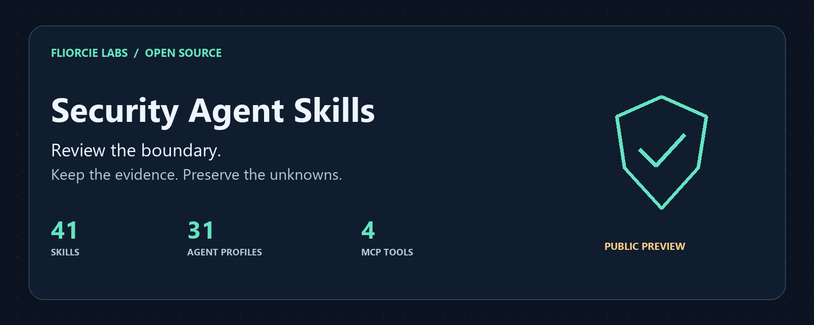

# Security Agent Skills

[English](README.md) · [日本語](README.ja.md) · 简体中文 · [한국어](README.ko.md) · [हिन्दी](README.hi.md) · [Español](README.es.md)



在本地审查 AI 工具和项目的安全边界。只加载相关技能，保留证据、未检查范围和未知项，让下一步决策更清楚。

本页是入门摘要译文。完整目录、输入契约和最新变更以 [英文文档](README.md) 为准。技能指令和代码标识符未翻译。

## 提供什么

| 类型 | 内容 |
|---|---|
| 41 项技能 | 审查外传迹象、依赖来源、MCP 权限、应用边界和智能体内部操作 |
| 31 个角色文档 | 使用 Markdown 定义范围、证据要求和报告规则 |
| 4 个 MCP 工具 | 通过 stdio 分析声明的攻击路径、检测回放、回归对比和技能选择 |

## 开始本地审查

需要 Python 3.11 或更高版本。将目标路径替换为已有项目文件夹。

```sh
git clone https://github.com/FliorcieLabs/security-agent-skills.git
cd security-agent-skills
python scripts/security_check.py egress ../my-project --format markdown --max-findings 5
```

静态审查即使未发现迹象，也返回退出码 `3` 和 `PARTIAL`。这表示覆盖范围有限，不代表目标已被证明安全。

已测试 Claude Code、Codex、Cursor 和受支持 Copilot 环境的安装目录布局及独立辅助程序执行。尚未验证所有宿主中的自动发现和真实交互，也不保证任意 AI 平台的原生兼容性。[安装](README.md#install-for-your-assistant) · [兼容性](docs/compatibility.md)

## 状态与数据边界

`0.1.0a4` 是开发预览版。辅助程序不需要 API 密钥或额外的 Python 运行时依赖，不会自行发送网络请求或执行被审查代码。交给 AI 宿主的内容仍受其提供商的数据政策约束。

15 个领域辅助程序仅检查声明的证据记录，不会自动扫描项目或独立验证证据。工具不执行渗透测试、DDoS 或沙箱。匹配结果是待核实线索，不是已确认漏洞、安全保证或合规认证。

## Fliorcie Labs 公开项目

| 项目 | 用途 |
|---|---|
| [Security Agent Skills](https://github.com/FliorcieLabs/security-agent-skills) | 本地安全审查和智能体操作流程 |
| [LLMWitness Community](https://github.com/FliorcieLabs/LLMWitness) | 单用户 localhost 开发遥测、尽力而为的模式清理和本地可检测篡改的回执 |
| [Fliorcie Bench](https://github.com/FliorcieLabs/fliorcie-bench) | 本地基准测试和一致性记录 |
| [Evidence Bundle Verifier](https://github.com/FliorcieLabs/fliorcie-evidence-bundle-verifier) | 离线检查证据包结构与内部完整性 |
| [Provider Adapter Kit](https://github.com/FliorcieLabs/fliorcie-provider-adapter-kit) | 适配器协议及本地一致性测试，不调用真实提供商 |

各项目有独立的状态、安装说明和许可证。原创代码采用 MIT；两个改编辅助模块保留 Apache-2.0 许可。[第三方声明](THIRD_PARTY_NOTICES.md) · [贡献指南](CONTRIBUTING.md)
