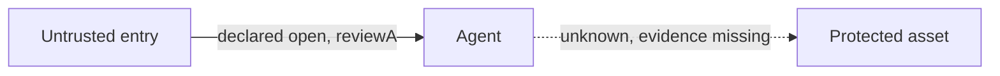

# Security decision experiments

Four workflows turn declared security questions into repeatable local experiments. They complement the existing scanners. They do not discover a complete application model, execute attacks, or establish that a product is safe.

| Question | Skill | Result |
|---|---|---|
| Which declared route reaches an asset, and which single edge interrupts it? | [Attack Path Rehearsal](../skills/attack-path-rehearsal) | Deterministic shortest paths, unknown evidence, and single-edge counterfactuals |
| Does this small detection predicate match its labeled fixtures? | [Detection Replay Lab](../skills/detection-replay-lab) | Expected versus observed rule IDs, false positives, missed labels, precision and recall |
| Did a candidate lose a detection or introduce noise? | [Security Regression Board](../skills/security-regression-board) | Paired metrics, per-case regressions, and incomplete cases excluded explicitly |
| Which skills should the assistant load for these goals? | [Security Skill Router](../skills/security-skill-router) | A capped selection, deferred work, and unknown goals |

## Run the supplied examples

```sh
python scripts/security_check.py attack-path examples/assurance/attack-path.json
python scripts/security_check.py detection-replay examples/assurance/detection-replay.json
python scripts/security_check.py regression-board examples/assurance/regression-board.json
python scripts/security_check.py skill-route examples/assurance/skill-route.json
```

Run from the checkout. Each valid example returns PARTIAL, exit 3. The attack-path example contains an unknown vault edge. The replay example deliberately misses a renamed approval field. The comparison example excludes an unavailable host. The router example defers a third skill because its cap is two. These outcomes show what remains unresolved.

Use default JSON output to see details. Markdown summaries omit those details. `--output` writes a full report to a new file and refuses overwrite. An installed bundle uses its `scripts/run.py` with the same record and no command name. Every skill includes its exact contract and a synthetic example in `references/workflow.md`. The shared [JSON Schema](../schemas/assurance-v1.schema.json) describes shapes; helpers additionally enforce referential integrity and semantic constraints.

## A path is a hypothesis to check



The example cannot establish an open entry-to-vault route. Supply evidence for the second edge only after reviewing it. If both edges are declared open with evidence references, removing either interrupts the only declared route. Add an alternate route and the helper recalculates the counterfactual. It never modifies an application or verifies those references.

An edge marked blocked is excluded from traversal. An open edge with no evidence is treated as unknown. One deterministic shortest route is shown per asset; this is not enumeration of every path. Removing a single edge evaluates graph connectivity, not operational feasibility, control cost, a complete minimum cut, or exploitability. No declared path is not a clean bill of health.

## Measure improvements without hiding failures

```sh
python scripts/benchmark_assurance.py
```

Eight independently authored synthetic events compare a deliberately broad text baseline with exact field predicates. Neither implementation represents the reference repository. Expected results:

| Metric | Toy text baseline | Exact field replay |
|---|---|---|
| True positives | 2 | 1 |
| False positives | 3 | 0 |
| False negatives | 0 | 1 |
| Precision | 0.40 | 1.00 |
| Recall | 1.00 | 0.50 |
| F1 | 0.5714 | 0.6667 |

The exact predicate removes noise but misses schema drift. Higher F1 does not establish overall superiority. The regression board preserves that lost detection. Real comparisons need frozen fixtures, trusted labels, exact source revisions, actual captured outputs, the same execution budgets, and complete or explicitly excluded cases. Never fill in a competitor's outputs by guessing. There is no measured performance comparison against the reference library or an AI model.

The same script measures the bytes of three selected skill entrypoints versus all 26 entrypoints. It prints the actual values for the current checkout. This is a document-selection measure, not tokenizer output, context usage, latency, or billing. Workflow references and tool schemas add context when loaded. MCP includes both structured content and a text representation for compatibility, so its wire size is not a token-saving claim.

## Platform boundary

Markdown profiles can be read by assistants that accept instructions. Python helpers require a local execution tool. The optional [stdio MCP server](mcp.md) exposes these four record operations to clients supporting the negotiated protocol. A platform without those capabilities cannot execute the helpers through a text-only conversation. Host registration, permissions, discovery, and model decisions remain separate concerns. See [recorded compatibility](compatibility.md).
